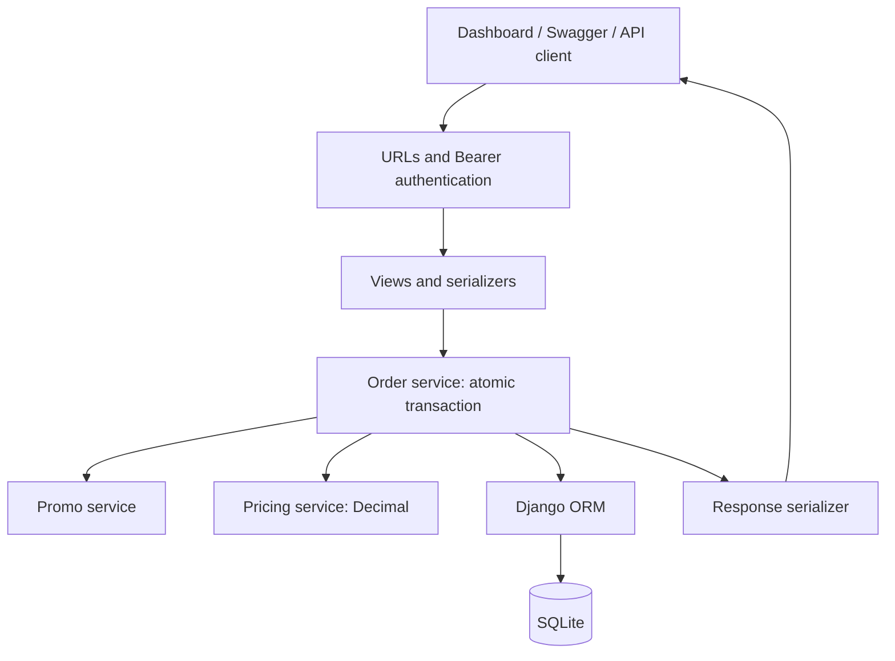

# Technical Workflow

## Architecture

A Django monolith with a service layer and one SQLite database. Views handle HTTP, serializers validate input, services implement checkout rules, and ORM models persist data. Pricing uses pure Python; promo and order services depend on Django's ORM.

## Data model

| Entity | Role and relationships |
| --- | --- |
| Event | Active flag, name, and start time |
| EventSection | Event, price, capacity, and reserved count; unique name per event |
| PromoCode | Optional event, discount type/value/cap, date window, minimum quantity, usage counters, and soft deletion |
| Order | User, event, optional promo, price breakdown, status, and creation time |
| Ticket | Order, section, and unit price at checkout |
| Payment | One pending payment per order, amount, and creation time |

Promo codes are trimmed and uppercased on save and lookup. The default promo manager excludes soft-deleted records; `all_objects` includes them for administration and checkout locking. The validator explicitly rejects deleted records.

## Order creation

1. `POST /api/orders/` authenticates the user and validates `event_id`, non-empty `sections`, and optional `promo_code`. Each section requires a positive ID and quantity from 1 to 20.
2. The order service rejects duplicate section IDs and starts `transaction.atomic()`.
3. It checks that the event is active, retrieves the promo with `select_for_update()`, and validates its date window, remaining uses, event eligibility, and minimum total quantity.
4. It requests section locks in sorted ID order, verifies event ownership, and checks `capacity - reserved` against quantity.
5. Pricing calculates subtotal, fees, and discount using `Decimal`. Discounts cannot exceed the subtotal or configured cap. Amounts round to two decimal places with `ROUND_HALF_UP`.
6. It creates the order and tickets, updates reserved counts using `F()` expressions, creates a pending payment, and increments promo usage once.
7. Successful transaction exit commits all writes; the view reloads related data and returns `201 Created`. An exception rolls back the writes.

`POST /api/promos/validate/` checks eligibility without changing usage or inventory. It does not guarantee that the promo or tickets will remain available for a later checkout.

## Response contract

- `200`: login, event/order listing, and successful promo validation.
- `201`: order created.
- `400`: invalid request fields, ineligible promo, invalid section, duplicate section, or insufficient inventory.
- `401`: invalid login or missing/invalid Bearer token.
- `404`: missing/inactive event or missing/deleted promo.

Business-rule errors use `{"detail": "..."}`. Serializer errors use field-keyed messages. The wrong-event message is exactly `Promo code is not valid for this event`.

## Query and memory considerations

Order history is limited to 30 orders. `select_related()` fetches event, promo, and payment data, while `prefetch_related()` fetches tickets and sections without a separate query per record. Ticket creation uses `bulk_create()`. Event listing is currently unpaginated, so memory usage grows with the event catalog.

Atomic transactions protect rollback. `F()` expressions update counters in the database. SQLite does not provide the row-level locking needed to guarantee promo and inventory limits under concurrent checkout; PostgreSQL concurrency testing is required before production use.

## Configuration

| Environment variable | Default / purpose |
| --- | --- |
| `DJANGO_DEBUG` | `1` for local development |
| `DJANGO_SECRET_KEY` | Local fallback; an explicit value is required when debug is disabled |
| `DJANGO_ALLOWED_HOSTS` | `127.0.0.1,localhost,testserver` |

Settings read process environment variables. `.env.example` documents them; `.env` files are not loaded automatically. SQLite data lives in `db.sqlite3`. Database schema changes are maintained in `apps/core/migrations/`.

## Verification

Use `python manage.py check` and `python manage.py test tests -v 2`. See [Test matrix](TEST_MATRIX.md) for covered cases. Payment processing, token expiry, checkout idempotency, and production deployment are outside the implemented scope.
